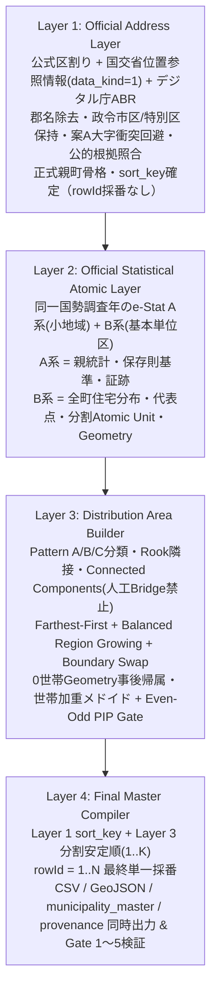

# POSTING MAP — マスターデータ生成仕様書 (Universal Design Contract)
## DISTRICT_DATA_ACQUISITION_RULE.md
### Official Address → Official Statistical Atomic → Distribution Area Builder → Final Master Compiler

- **Version**: 3.2 (FINAL DESIGN CONTRACT — Universal Topology & Feasibility Rectification: Move Type A/B, Minor Island Mode A/B, `K_min` Floor & `>700` Strict Contract)
- **Status**: OFFICIAL STANDARD (SSOT — Stage 7C Authority v3.2 Locked)
- **Scope**: Universal POSTING MAP 全国地区マスターデータ生成（`data/address_master.csv`, `data/boundaries.geojson`, `data/municipality_master.csv`, `data/provenance.json`）
- **関連規程**: `docs/architecture/01_DESIGN_CONTRACT.md` / `docs/architecture/ADDRESS_EXTRACTION_RULE.md` / `docs/data/DATA_DICTIONARY.md` / `docs/operations/DISTRICT_PROVISIONING_RUNBOOK.md` / `.agents/rules/district-data-transition-rule.md` / `.agents/skills/address-master-generation/SKILL.md`

---

# 0. 基本設計契約（Core Design Contracts）— ABSOLUTE

## 0.1 `e-Stat 1行 ≠ POSTING MAP 1配布エリア`
e-Stat A系「小地域（町丁・字等別）」およびB系「基本単位区」は、POSTING MAP配布エリアを構成するための**公的統計・地理の原材料**である。

以下を絶対禁止とする：
- e-Stat A系 `KEY_CODE` 1件を、そのまま無条件で1ピン（1行）にすること。
- e-Stat A系の `1:N` 件数を、そのままPOSTING MAPの配布エリア数とみなすこと。
- e-Stat B系基本単位区1件を、そのまま無条件で1配布エリアとみなすこと。

POSTING MAPの最終的な配布エリア数・Geometry・世帯数・人口・代表点を決定する責務は、**Layer 3 — Distribution Area Builder** のみが持つ。

例（架空名称）：
- `あおば町`：A系が2区域に分かれていても、親町合計が170世帯で住宅塊が一体なら原則1配布エリアとする。
- `みどり町`：A系が4区域（うち2区域が0世帯）に分かれていても、親町合計が360世帯なら0世帯区域を独立ピンにせず原則1配布エリアとする。
- `さくら町`：A系が20区域に細分化されていても、そのまま20ピンにせず、一旦正式親町へ集約した上で、B系基本単位区から適正粒度（原則400〜700世帯、中心550世帯）へ再構成する。

---

## 0.2 `rowId` 最終単一採番原則
`rowId`（`1..N`）は、Layer 3で全配布エリアの分割・統合・代表点・表示順が確定した後、**Layer 4 — Final Master Compiler で最後に1回だけ採番**する。

以下を絶対禁止とする：
- Layer 1〜3の途中工程で最終 `rowId` を確定すること。
- 途中で仮 `rowId` を付与し、後続の分割・統合で振り直すこと。
- e-Statの行番号や `KEY_CODE` 順を最終 `rowId` とみなすこと。

---

## 0.3 完成データ正本原則（H-App / Dashboard / Spreadsheet 共通SSOT）
以下は全判定・正規化・細分化が完了した**完成正本（SSOT）**である：
- `data/address_master.csv`
- `data/boundaries.geojson`
- `data/municipality_master.csv`
- `data/provenance.json`

H-App・Manager Dashboard・Spreadsheetは完成正本をそのまま共通利用し、クライアント・バックエンド側での二次解釈や動的補完を一切行わない。また、本仕様によるマスターデータ生成方式の再構築において、共通Runtime（`active/**`）のH-App・Dashboard実装およびGAS・Spreadsheet実装は一切変更しない。

禁止例：
- H-Appだけで `(1), (2), (3)` を動的生成する前提でマスターデータを未完成のまま出力すること。
- Dashboardだけで別の町名表示を作る前提でマスターデータを出力すること。
- 世帯数・人口を画面側で擬似補完・均等割りする前提でマスターデータを出力すること。
- 配布エリアの統合・分割をUI側で行う前提でマスターデータを出力すること。

---

## 0.4 外部Google Maps「詳細地図」検索と表示町名の契約
分割配布エリアの `town_name`（表示用町名）は、マスターデータ生成段階（Layer 4）で `サンプル町 (1)`、`サンプル町 (2)` として完成・確定させる。

Consumer（H-AppのGoogle Maps検索URL生成処理）は、外部Google Maps検索文字列を生成する瞬間のみ、`town_name` から以下を除去して正式親町名（`provenance.json` の `official_town_name` 相当）で検索する：
1. 先頭の形式的な `^大字`
2. 末尾の分割連番 `\s*\(\d+\)$`

例（架空名称）：
```text
〇〇市 サンプル町 (2) → 〇〇市 サンプル町
〇〇市 大字サンプル町 (1) → 〇〇市 サンプル町
```
分割された複数配布エリアが外部Google Maps検索上で同一の正式親町名として開かれることは仕様上の正式契約であり、マスターデータの `town_name` 列自体は必ず `(N)` 付き完成表示名を保持する。現行H-App（`active/app.js`, `active/ui.js`）およびDashboard（`active/dashboard.js`）の実装はこの完成表示名・検索契約と完全互換であり、`active/**` の変更は行わない。

---

## 0.5 ゼロ人間介入原則・原本Drive隔離原則・既存地区非遡及保護原則
1. **ゼロ人間介入の原則（Zero Human Intervention）**:
   - マスターデータ生成に必要な公定一次資料の調達・解凍・検証・変換は、100% AIエージェントが自律スクリプトにより実行する。人間にブラウザでの手動ダウンロードやファイル配置を依頼することを永久に禁止する。
2. **原本はDrive・確定データはGit（Drive Storage & Provenance Doctrine）**:
   - 外部から取得した地区固有の一次原本（ZIP, Shapefile, CSV, PDF等）は、地区専用 Google Drive（`SOURCE_ARCHIVE/` 領域）へ恒久保存する。Gitリポジトリには検証済みの確定実行データ（`data/`）と正式スクリプトのみを配置し、原本バイナリや一時作業物（`scratch/`、`data/raw_reference/` 等）をGit追跡下に残存させてはならない。
3. **既存稼働地区データの非遡及保護原則（Non-Migration Principle）**:
   - 既に確定・本番稼働している他地区の確定データおよび既存の `rowId` は、本仕様の改定によって無断で再生成・改番・Migrationしてはならない。対象地区のマスター再構築はMASTERの明示承認（Authorization Envelope）がある場合に限り実行する。
4. **Universal Topology Rectification Rationale（v3.2 改訂の普遍的トポロジー根拠）**:
   - 実在する住宅地トポロジーは、関節点（Articulation Point）によって拘束された半島状・枝状の有世帯連結構造を含み得る（`real residential topology may contain articulation-constrained branches`）。また、0世帯基本単位区を含む町内全基本単位区グラフ（All-Unit Rook Graph）上でも接触しない完全分離型の小規模住宅島（`< 200` 世帯）が存在し得る。
   - 本仕様 v3.2 は、特定の地区名・自治体名・町名・件数に依存しない全国共通の普遍的トポロジー規則として、① 関節点における決定論的連結枝一括移動（Move Type B: Deterministic Connected Branch Transfer）、② $H \ge 1000$ における $K_{\min} = \lceil H / 700 \rceil$ 下限維持（$K < K_{\min}$ への減算禁止と解消不能時 `HARD STOP`）、③ 通常の複数 Atomic Unit クラスタに対する `> 700` 例外の不許可（`ATOMIC_UNIT_TOO_LARGE` 限定）、および ④ 小規模住宅島帰属の 2 Mode（Mode A / Mode B）を規定する。

---

# 1. 全体アーキテクチャ — 4 Layers

マスターデータの生成は、責務が厳格に分離された以下の **4層（Layer 1 〜 Layer 4）** の単方向パイプラインとして構成する。



---

# 2. Layer 1 — Official Address Layer（公式親町骨格の確定）

## 2.1 目的と主入力
対象地区内に存在する正式な市区町村名・町丁目の**親骨格（Official Parent Town Set）**を、統計やピン分割から完全に独立して確定する。

| 役割 | データソース | 使用範囲・検証要件 |
| :--- | :--- | :--- |
| **公式区割り** | 対象選挙に適用される法令の施行版（衆議院小選挙区は公職選挙法 別表第一）および分割自治体における自治体公表の公式町名・区域対応資料 | 対象町域の選別のみ（§2.2）。スクリプト内への地区固有辞書のハードコードは禁止し、`--electoral-mapping` 外部根拠ファイルとして入力する。 |
| **住所の母集合（正本）** | 国土交通省 位置参照情報「大字・町丁目レベル（`data_kind=1`）」の**最新版**（市区町村コード5桁単位で自動取得） | `city_name` / `parent_town_name` はこの母集合からのみ抽出する。同梱メタデータXML（JMP 2.0 / ISO 19115）の `citation` 内から `dateType=001`（原資料作成日）を厳格抽出し、SHA-256とともに記録する（`data_kind=0` 街区レベル混入や作成日欠損は即時 HARD STOP）。 |
| **読み仮名（整列補助）** | デジタル庁 アドレス・ベース・レジストリ（ABR）町字マスター（`mt_town_fullset_pref*.csv`） | 五十音順整列キー（`sort_key`）の導出専用（§2.4）。母集合に対する町域の追加・削除・改名には一切使用しない。 |

- **後段データの混入禁止**: Layer 1 の親町骨格決定に、e-Stat、`households`、`population`、境界Polygon、投票率等を一切使用してはならない。

---

## 2.2 ルール L1-1: 公式区割りの確定と適用（Electoral Boundary Application）
1. **適用法令の施行版の特定**: 対象選挙（選挙種別と選挙期日または公示・告示日）を特定し、e-Gov等の公式法令データで ① 施行版、② 未施行改正、③ 改正法附則の経過措置を確認する。
2. **区割りの適用**:
   - 市区町村の全域が対象地区に属する場合：その市区町村の母集合の全町域を対象とする。
   - 市区町村の一部のみが属する場合（分割自治体）：法令の区域記述（例：`〇〇市△△地区管内`）を、当該自治体が公表する公式の町名・区域対応資料で**町丁目単位**に照合して選別し、対象外選挙区に属する町域を厳格に除外する。
3. **HARD STOP 条件**:
   - 適用法令の版または経過措置が一意に決まらない場合。
   - 分割自治体の区域を町丁目へ照合できる公式資料が存在しない場合。
   - 1つの町丁目が複数の選挙区にまたがる、または帰属を一意に判定できない場合（推測補完は永久禁止）。

---

## 2.3 ルール L1-2: 正規化と名称衝突回避（Normalization & Plan A Collision Avoidance）
1. **`city_name`（自治体名正規化）**:
   - **郡名除去**: 郡部町村について、母集合の「市区町村名」から先頭の郡名のみを除去する（例：`〇〇郡△△町` ➔ `△△町`、`〇〇郡□□村` ➔ `□□村`）。
   - **政令指定都市の行政区保持**: 政令指定都市の区は「市名＋区名」を完全保持し、区名を除去しない（例：`〇〇市△△区` ➔ `〇〇市△△区`）。
   - **東京都特別区保持**: 東京都の特別区（23区）は特別区名をそのまま自治体名として保持する（例：`〇〇区` ➔ `〇〇区`）。
2. **`parent_town_name`（原則と案A大字衝突回避）**:
   - **原則**: 母集合の「大字町丁目名」から、先頭の形式的な「大字」接頭辞（`^大字`、ただし町名自体が「大字」のみの場合を除く）を除去する。それ以外の表記（`ケ` / `ヶ` 等の異体字を含む）は変更しない。
   - **案A（同名異コード衝突時の原文保持）**: 同一自治体内において、先頭 `^大字` の除去によって別の独立した公式町域（異なる大字町丁目コードを持つ町域）と正規化名称が重複（衝突）する場合、**衝突するレコードの原文名称（「大字〇〇」表記）をそのまま保持して独立した正式親町として分離維持**する（例：`サンプル町`［コードA］と `大字サンプル町`［コードB］が共存する場合、後者は `大字サンプル町` を維持）。
   - **丁目の包含**: 公式データに「丁目」が存在しない町字は町字名そのものを1親町とし、公式に「丁目」が存在する町字は各丁目まで含めた名称（例：`さくら町一丁目`, `さくら町二丁目`）をそれぞれ独立した1親町とする。
   - **下位階層の人工生成禁止**: Layer 1 において、`parent_town_name` より下位の小字・方角（`北部`/`南部`等）・通称・地番範囲・人工的括弧名称を探索・推測・生成・地区固有辞書補完することを一切禁止する。
   - **特定町名のハードコード禁止**: スクリプトや規程内に実在の特定自治体・町名を条件分岐として記述することは永久に禁止する。
3. **HARD STOP 条件**:
   - 案A（原文名称保持）を適用してもなお同一自治体内で同一名称に異なる公式町丁目コードが存在する場合、または区別不能な衝突が残存する場合は、自動統合・推測改名を禁止し直ちに **FATAL HARD STOP** する。

---

## 2.4 ルール L1-3: ABR階層照合・五十音順整列キー（`sort_key`）・公的根拠Reconciliation
1. **ABR階層仕様（`machiaza_type` 準拠）**:
   - 市町村読み：`city_kana`（政令指定都市の区は `city_kana + ward_kana`）
   - 町字階層：
     - `machiaza_type = 1`（大字）：`oaza_cho` と `oaza_cho_kana`
     - `machiaza_type = 2`（丁目）：基底町名 `oaza_cho`（読み：`oaza_cho_kana`）と `chome`（丁番数値：`chome_number`）
     - `machiaza_type = 3`（小字）：`oaza_cho` が存在する場合は `oaza_cho + koaza`（読み：`oaza_cho_kana + koaza_kana`）、空の場合は `koaza`（読み：`koaza_kana`）
2. **公式コード優先照合と案A対応**:
   - 公式コード（`<city_code>:<town_code>`）および原文名称一致を最優先とし、案Aにより原文保持された町域（`大字〇〇`）は無条件で「大字」を除去せず原文名称と正規化名称の対応を維持して基底読みを取得する。
   - 原本検証（`verify_abr_master`）では物理構造・必須列・コード体系（6桁 `lg_code` 先頭5桁一致）のみを検証し、母集合町域に対する読み仮名の完全性は外部根拠データ補完後のゲートで判定する。
3. **表記乖離・読み欠落の公的Evidence解決（`--reading-reconciliation`）**:
   - MLIT母集合とABRの間で異体字・冠称差・新旧町名差・読み欠落が存在する場合、座標近接や文字列類似による推測同定を永久に禁止する。
   - 当該自治体が公表する公的資料で同一性・公式読みを客観確認し、複合キー `"<city_code>:<town_code>"` による外部根拠JSON（8項目必須：`raw_town_name`, `reconciled_reading`, `reconciled_target_official_name`, `source_provider`, `source_document_title`, `source_url`, `source_section_or_page`, `verified_date`）として入力する。未解決行が1件でも残存する場合は直ちに **FATAL HARD STOP** する。
4. **`sort_key`（決定論的整列順序）**:
   - 第1キー：`city_kana`（市町村公式読み五十音順）
   - 第2キー：`city_code`（5桁全国地方公共団体コード昇順）
   - 第3キー：同一 `city_name` 内における基底町域の公式読み仮名五十音順（清音化正規化キー＋原文カナ順）
   - 第4キー：同一基底町名における丁目の数値順（`0`［丁目なし］, `1`, `2`, `3`... ※丁目の読み文字列連結で比較しない）
   - 第5キー：`parent_town_name`（UTF-8コードポイント昇順）
   - 第6キー：`parent_town_code`（国交省12桁大字町丁目コード昇順）

---

## 2.5 Layer 1 出力概念スキーマと件数非固定契約
Layer 1 の確定出力は以下の親町レコード集合であり、**この段階では `rowId` を採番しない**：
```text
city_code, city_name, parent_town_code, parent_town_name, sort_key, mlit_reference_lat, mlit_reference_lon, matching_evidence
```
- **件数非固定原則**: Layer 1 のExpected Set（期待される正式親町集合）は、「公式区割り ＋ MLIT母集合 ＋ ABR ＋ 公式照合Evidence」から決定論的に導出された正式親町集合そのものとする。特定地区の固定件数をUniversal生成ロジックやGate条件にハードコードすることを永久に禁止する。
- **不変Authority契約**: Layer 1 で確定した正式親町集合に対し、Layer 2〜4 で親町の無断削除・無断追加・無断改名を行ってはならない。

---

# 3. Layer 2 — Official Statistical Atomic Layer（公式統計・空間原子の取得と正規化）

## 3.1 A系・B系 同一国勢調査年の動的解決（Dynamic Common Census Year Resolution）
1. **A/B同一調査年原則**:
   - e-Stat A系「小地域（町丁・字等別）」と B系「基本単位区」は、**必ず同一の国勢調査年**のデータを使用しなければならない（A系とB系で異なる調査年を混在させることは禁止）。
2. **最新完全共通年度の自律動的解決**:
   - `'2020'` 等の特定調査年をスクリプトにハードコードすることを禁止する。
   - e-Stat API / カタログから候補調査年を動的に降順探索し、**対象地区の全構成自治体において A系（統計表＋小地域境界Shapefile）および B系（基本単位区統計表＋基本単位区境界Shapefile）の双方が完全に揃う「最新完全共通年度」**を自律決定し、Provenanceに記録する。
3. **HARD STOP 条件**:
   - 対象自治体間でA系またはB系の提供年が揃わない場合、またはA系とB系の調査年が一致しない場合は直ちに **FATAL HARD STOP** する。

---

## 3.2 A系（小地域）の役割・`KIGO_E` 正規化契約・カーディナリティ監査
e-Stat A系「小地域（町丁・字等別）」は以下の責務に限定して使用する：
- 正式親町の公式世帯数合計（$H_{\text{parent}, A}$）・公式人口合計（$P_{\text{parent}, A}$）の確定および統計保存則の基準
- A系小地域コード（`KEY_CODE`）および全構成Polygonの証跡保持

### 1. A系 `KIGO_E` 正規化契約 — FINAL DECISION（行順依存・後勝ち上書きの絶対禁止）
e-Stat A系境界Shapefile（`r2ka`）において、同一 `KEY_CODE` が複数のレコード（`KIGO_E = E1, E2, E3...`：飛び地等）に分かれて収録されている場合、**DBFの行順による後勝ち上書き（または先勝ち破棄）を絶対禁止**とする。同一 `KEY_CODE` は以下の規則により**1つの公式小地域**として決定論的に正規化する：
1. **統計値の保持（公式 `KIGO_E` 意味論準拠）**:
   - e-Stat公式仕様において、同一 `KEY_CODE` の複数レコードのうち `KIGO_E == "E1"` には当該 `KEY_CODE` 全体の合算統計値（`SETAI`, `JINKO`）が格納され、`E2` 以降には個別パーツ値または重複属性が格納される。
   - したがって、同一 `KEY_CODE` の公式統計値は **`KIGO_E == "E1"` のレコード（`KIGO_E` が全レコード空欄の単一レコードの場合はそのレコード）の統計値を唯一採用**し、`E2, E3...` の統計値を二重加算したり、`E2, E3...` の値で `E1` の統計値を上書きしてはならない。
2. **Geometryの完全保持**:
   - `E1` だけでなく `E2, E3...` のすべてのPolygonリングを欠落なく結合（MultiPolygon化）し、同一 `KEY_CODE` の全Geometryを空間データおよびProvenance証跡として保持する。
3. **行順非依存性**:
   - DBFファイル内のレコード出現順序が入れ替わっても、正規化後の `KEY_CODE` 別統計値およびGeometryは100%不変でなければならない。

### 2. Layer 1 正式親町との結合カーディナリティ監査と `1:0` / B系 `S_NAME` 親帰属契約 — FINAL DECISION
Layer 1 正式親町との空間・名称結合カーディナリティ（`0:1 / 1:1 / 1:N / N:1 / 1:0`）を以下の通り監査する：
- `0:1`：対象選挙区・自治体外のレコードは厳格除外。
- `1:1`：正式親町1件にA系小地域（正規化後 `KEY_CODE`）1件が対応。
- `1:N`：正式親町1件にA系小地域複数件が対応。**Layer 2では最終CSV行へ展開せず、当該正式親町の子要素集合として集約保持する。**
- `N:1`：複数の正式親町が同一のA系 `KEY_CODE` を主張した場合は二重計上防止のため即時 **FATAL HARD STOP**。
- `1:0`（A系独立小地域不在親町とB系 `S_NAME` の扱い — **FINAL DECISION**）：
  - 正式親町に対応する独立したA系小地域が存在しない場合、原則 **FATAL HARD STOP** とし、外部根拠ファイル（`--estat-reconciliation`）にキー `"<city_code>:<parent_town_name>"` で8必須属性（`city_code`, `skeleton_town_name`, `reconciled_status: "no_independent_estat_small_area"`, `source_provider`, `source_document_title`, `source_url`, `source_section_or_page`, `verified_date`）が公的資料に基づき完全登録されている場合のみ、`Pattern C (C_ZERO_OR_UNMATCHED)` として通過を認める。
  - **B系 `S_NAME` による統計切り出しの禁止**: A系で他親町へ合算されている `1:0` 親町について、B系基本単位区の `S_NAME` 属性に当該町名文字列が現れることのみを根拠として、合算元親町（公式階層コード `PREF + CITY + KIHON1` で紐づく親町）から世帯数・人口・基本単位区を切り出してはならない。A系・B系の親町帰属Authorityは公式階層コード（`PREF, CITY, KIHON1, KIHON2`）に統一し、`1:0` 親町は `Pattern C`（`households=""`, `population=""`, `e_stat_code=""`）として保持した上で、B系 `S_NAME` 一致事実および該当基本単位区コードは `provenance.json` の証跡（`estat_reconciliation_evidence` / `matching_evidence`）にのみ記録する。

---

## 3.3 B系（基本単位区）の役割・全町使用原則・Atomic Unit 粒度契約 — FINAL DECISION
e-Stat B系「基本単位区」は、全国共通の配布エリア設計 **Atomic Unit（分割不能な最小統計・空間原子）** として使用する。

1. **全町B系使用原則**:
   - B系は巨大町分割の例外処理専用ではない。**Layer 1 の全正式親町（Pattern A を含む）についてB系を読み込み、住宅分布把握および世帯加重メドイド代表点の算出に使用する。** これにより、分割しない町でも0世帯の山林・農地・河川に引きずられない住宅密集地中心の代表点を導出する。
2. **B系 Atomic Unit 粒度契約 — FINAL DECISION（`r2kb` 1 `KEY_CODE` = 1 Atomic Unit）**:
   - Layer 3 における分割・統合・代表点計算の最小単位（Atomic Unit）は、**B系境界Shapefile（`r2kb`）の 1 `KEY_CODE` ＝ 1 Atomic Unit** とする。
   - **事前統合の絶対禁止**:
     - `K_AREA = KIHON1 + KIHON2 + KIHON3`（調査区・街区グループ単位等）へ事前統合してはならない。
     - `K_AREA` 単位を分割不能な Atomic Unit として扱ってはならない。
     - 複数の B系 `KEY_CODE` の世帯数・人口・Geometryを Layer 3 の前に束ねてからクラスタリングへ渡してはならない。
   - `KIHON1 / KIHON2 / KIHON3` は公式階層照合および正式親町対応の属性として使用できるが、Layer 3 の Atomic Unit Identity は厳格に `r2kb` の `KEY_CODE` とする。
   - なお、`r2kb` の単一 `KEY_CODE` 自体が単独で `700` 世帯を超えるケース（大規模高層マンション等）に備え、§4.2.2 の `ATOMIC_UNIT_TOO_LARGE` 例外規定は Universal 契約として維持する。

---

## 3.4 B系特殊属性の集計前正規化規則
B系基本単位区の統計表・境界Shapefileに含まれる以下の特殊属性・秘匿・合算記号は、**統計集計および空間クラスタリングの前に、`r2kb` の `KEY_CODE` 単位で必ず正規化・解釈**しなければならない：
1. **秘匿・合算処理（Confidentiality / Merged Aggregation）**:
   - 秘匿記号（`X`、`-` 等）や他基本単位区への合算フラグ（`KIGO_E` 等）が存在する場合、数値変換エラーや0世帯誤認を起こさず、e-Stat公式仕様に従い同一 `KEY_CODE` 内の `E1` 統計採用・合算先・秘匿状態を正規化する。
2. **同一 `KEY_CODE` 内の複数Polygonパーツ・水面・特殊調査区**:
   - 同一 `KEY_CODE` が複数レコード（`E1, E2...`）や複数Polygonパーツ（飛び地）を持つ場合、同一 `KEY_CODE` の統計値をパーツ数で重複加算してはならない（統計は `r2kb` の `KEY_CODE` 単位で1回のみ計上し、GeometryはMultiPolygonとして統合保持する）。
3. **0世帯基本単位区の保持**:
   - `SETAI == 0` の基本単位区（`KEY_CODE`）を「ゴミ行」として削除してはならない。単独配布ピンにはせず、世帯加重計算の重みは `0` とするが、町域内の空間トポロジー（小規模住宅島の帰属経路および最終配布エリアPolygonの隙間なき構成）および証跡（`zero_household_area_codes`）として完全に保持する。

---

## 3.5 A系親統計とB系合計の保存則監査およびB系不在時フォールバック契約
1. **A/B統計整合性監査**:
   - 各正式親町について、A系親統計 $(H_{\text{parent}, A}, P_{\text{parent}, A})$ と、当該親町に属する正規化後B系基本単位区の合計 $(\sum_{b} \text{SETAI}_b, \sum_{b} \text{JINKO}_b)$ を突合する。
   - **人工補正の禁止**: A系親統計とB系合計が不一致の場合に、比率按分・端数調整・推測による人工補正を行うことを絶対禁止する。
   - e-Statの公式秘匿・合算規則（§3.4）で説明できない不一致が検出された場合は、直ちに **FATAL HARD STOP** とし、Evidence監査レポートを出力する。
2. **B系が公式に利用できない親町のフォールバック契約**:
   - **ケース1（`1:0` 公式統計未対応町）**: A系・B系ともに独立統計が存在せず、§3.2 の8属性 `--estat-reconciliation` Evidenceが検証済みの親町は、`Pattern C` として親町1行を保持し、`households=""`, `population=""`, `e_stat_code=""` とする。
   - **ケース2（町全体が `H == 0` の親町）**: `Pattern C` として親町1行を保持し、`households=0`, `population=0` とする。
   - **ケース3（A系 `1 <= H <= 800` が存在するが、e-Stat秘匿合算等により当該町単独の有世帯B系代表点が分離不能な場合）**: `Pattern A`（親町1行）としてA系親統計 $(H_{\text{parent}, A}, P_{\text{parent}, A})$ を保持し、A系実領域Polygonに対する決定論的 `point-on-surface`（§5.2）を代表点として採用し、`provenance.json` に `"b_series_fallback_reason"` を記録する。`H > 800` の親町でB系が利用不能な場合は推測分割を禁止し **HARD STOP** とする。

---

## 3.6 多重入れ子トポロジー幾何契約（Ring Containment Hierarchy & Even-Odd Rule）
1. **Ring Containment Hierarchy（リング包含深度階層）**:
   - 外周（depth 0）➔ 穴/湖（depth 1）➔ 穴の中の島（depth 2）➔ 島の中の池（depth 3）... の多重入れ子構造を包含深度階層として解析する。
2. **深度偶奇と回転方向（CW/CCW）の整合性**:
   - 偶数深度（depth 0, 2, 4...）：**Solid 実領域（外周・島）** ➔ 平面座標上で CW（符号付き面積 $< 0$、またはGeoJSON出力時 RFC 7946 正規化準拠）
   - 奇数深度（depth 1, 3, 5...）：**Void 空間（穴・湖）** ➔ 偶数深度と逆回転
   - 深度偶奇と回転方向が矛盾する不正リングはトポロジー異常として検知する。
3. **Even-Odd 包含判定**:
   - 点 $P(x, y)$ を包含する境界リング総数 $M$ が奇数（$M \bmod 2 == 1$）の場合のみ実領域内部（`INSIDE`）と判定し、偶数の場合は穴・外部（`OUTSIDE`）として厳格排除する。

---

# 4. Layer 3 — Distribution Area Builder（配布エリア構築エンジン）

Layer 3 のみがPOSTING MAPの最終配布エリア（行数・分割・統合・代表点・最終Geometry）を決定する。

---

## 4.1 Pattern分類規則

正式親町の公式世帯数合計を $H$ とする。

### 1. Pattern A — `A_NORMAL`（1正式親町 ＝ 1配布エリア）
- **対象条件**:
  $$1 \le H \le 800$$
  （または $801 \le H \le 999$ で空間判定により単一密集塊と判定された親町）
- **処理**:
  - A系が `1:1` であっても `1:N`（複数小地域）であっても、**1つの正式親町＝1つの配布エリア**へ統合する。
  - 町内の0世帯A系/B系区域を独立ピンとして切り出すことは禁止し、親町の単一配布エリアGeometryへ統合する。

### 2. Pattern B — `B_SPLIT`（B系基本単位区による適正粒度分割）
- **判定入口**:
  - **$H > 800$ の正式親町は、全件 B系基本単位区（`r2kb` 1 `KEY_CODE` = 1 Atomic Unit）による空間判定へ送る。**
  - **$801 \le H \le 999$ の親町（`ODG-01 — CLOSED` 確定判定規則）**:
    以下の2段階の決定論的空間判定により `Pattern B (K=2)` か `Pattern A (K=1)` かを一意に決定する：
    1. **Step 1 — Real Residential Islands（複数主要住宅島判定）**:
       有世帯B系 Atomic Unit（$\text{SETAI}_b > 0$）の Rook Connected Components の中に、**独立して `200` 世帯以上を持つ住宅島が 2個以上** 存在する場合、`K=1`（単一ピン）は禁止し、**`K=2` 分割候補**とする（人工ブリッジによる島間結合は絶対禁止）。
    2. **Step 2 — Single Major Residential Island（単一主要住宅島時のメドイド平均距離 $D_1$ 判定）**:
       Step 1 に該当しない場合（`>= 200` 世帯の主要住宅島が1個の場合）、親町全体の `K=1` 世帯加重メドイド（§5.1）から全有世帯B系 Atomic Unit 公式代表点までの**世帯加重平均距離 $D_1$** を §4.9 の `dist_m` 仕様により算出する：
       $$D_1 = \frac{\sum_{b \in B_{>0}} \text{SETAI}_b \cdot \text{dist\_m}(\text{medoid}, \text{point}_b)}{\sum_{b \in B_{>0}} \text{SETAI}_b}$$
       - **`D1 >= 400.000 m`** $\rightarrow$ **`K=2` 分割候補**
       - **`D1 < 400.000 m`** $\rightarrow$ **`Pattern A / K=1`（分割しない）**
       （※閾値 `400.000 m` は **POSTING MAP Universal Operational Parameter** として全国共通で固定する。地区ごとの閾値変更は禁止し、変更には設計契約の改定を要する。）
    3. **`K=2` 成立条件（Feasibility Condition）と `K=1` フォールバック**:
       Step 1 または Step 2 で `K=2` 分割候補となった $801 \le H \le 999$ の親町について、§4.5〜§4.7 により構成された2つのクラスタの有世帯Geometryがそれぞれ実空間上で連結であり、かつ各クラスタの世帯数が原則 **`400 〜 700` 世帯**（Atomic Unit 粒度の制約により不可避な場合のみ下限側の `GRANULARITY_EXCEPTION` `200 〜 399` 世帯を適用可。複数 Atomic Unit クラスタの `> 700` 世帯および人工按分は禁止）を満たす場合に `Pattern B (K=2)` として確定する。$801 \le H \le 999$ の親町において `K=2` 候補が当該成立条件を満たせない場合に限り、既存契約どおり `Pattern A (K=1)` へのフォールバックを許可する。
    4. **不採用条件（Pattern Authority への使用禁止）**:
       `H >= 900` 単独条件、有世帯面積閾値、世帯密度閾値、$\rho = D_2 / D_1$ 改善率閾値、および地区固有の条件分岐は Pattern Authority として採用しない（これらを `provenance.json` の診断値・参考指標として記録することは可）。
  - **$H \ge 1000$ の親町**:
    - 原則として全件 `Pattern B (K >= K_min)` として分割する（単一基本単位区のみで $H \ge 1000$ を構成する分割不能ケースを除く：§4.2.2）。$H \ge 1000$ の親町では $K < K_{\min} = \lceil H / 700 \rceil$ への減算・フォールバックは一切禁止する。

### 3. Pattern C — `C_ZERO_OR_UNMATCHED`（0世帯親町・公式統計未対応親町）
- **対象**:
  - 親町全体が $H == 0$（0世帯）の正式親町
  - e-Statに独立した親町統計が存在しない正式親町（`1:0` unmatched：§3.2 の8属性Evidence検証済み）
- **処理**:
  - 正式親町を **1行** として保持する。
  - **統計値の捏造・推測・按分およびB系 `S_NAME` からの切り出しを絶対禁止**する（$H=0$ 町は `households=0, population=0`、`1:0` 未対応町は `households="", population="", e_stat_code=""`）。
  - **公式A/B Polygon不在時の表現形式（`ODG-02 — CLOSED`）**:
    - `1:0` 未対応町等で公式A/B Polygonが存在しない場合、`boundaries.geojson` の当該Featureは **`"geometry": null`** とし、`properties` および `provenance.json` に **`"geometry_status": "UNAVAILABLE_OFFICIAL_POLYGON"`** を保持する（公式Polygonが存在する配布エリアは `"geometry_status": "OFFICIAL_POLYGON"`）。
    - MLIT代表点周囲の人工矩形Polygon生成、空のGeometryを公式境界のように偽装する処理、推測Polygon、他町Geometryの流用は絶対禁止とする。
  - 未対応状態および8属性公的Evidenceを `provenance.json` に完全保存する。

---

## 4.2 分割数 $K$ の数学的決定規則と粒度例外

### 4.2.1 原則目標帯と数学的 $K$ 決定式
- **目標中心**: `550` 世帯
- **原則許容帯**: `400 〜 700` 世帯
- **独立クラスタ禁止下限**: `200` 世帯未満

親町の公式世帯数合計 $H$ に対し、許容帯から導かれる $K$ の可能範囲 $[K_{\min}, K_{\max}]$ と第一候補 $K_{\text{target}}$ を次式で求める：
$$K_{\min} = \lceil H / 700 \rceil, \quad K_{\max} = \lfloor H / 400 \rfloor, \quad K_{\text{target}} = \text{round\_half\_up}(H / 550)$$
1. $K_{\min} \le K_{\max}$ の場合、閉区間 $[K_{\min}, K_{\max}]$ 内の整数であって $K_{\text{target}}$ に最も近い実現可能な整数 $K$ を初期候補として採用する（同距離の整数が2つある場合は小さい方の整数を優先）。
2. $K_{\min} > K_{\max}$ の場合（例：$801 \le H \le 1199$ で $K_{\min}=2, K_{\max}=2$ または $K_{\min}=2, K_{\max}=1$ の境界域）、`Pattern B` 対象町では $K = \max(K_{\min}, K_{\text{target}})$ を初期候補とする。
3. **$H \ge 1000$ における $K_{\min}$ 下限絶対維持契約**:
   - $H \ge 1000$ の親町（単一基本単位区のみで $H \ge 1000$ を構成する `ATOMIC_UNIT_TOO_LARGE` の場合を除く）において、分割数 $K$ を **$K < K_{\min} = \lceil H / 700 \rceil$ へ減算することを絶対禁止**する（鳩の巣原理により $K < K_{\min}$ では必ず $H_k > 700$ のクラスタが発生し、`> 700` 上限契約と矛盾するため）。

### 4.2.2 粒度例外（Atomic Unit Granularity Exceptions）と `< 200` / `> 700` 厳格契約
B系基本単位区は分割不能な Atomic Unit であるため、以下の例外規則および解消・停止規則を設ける：
1. **`200 〜 399` 世帯クラスタの例外許容（`GRANULARITY_EXCEPTION` — 下限側限定）**:
   - 基本単位区の世帯数構成および空間連結性の制約上、すべてのクラスタを `400 〜 700` 世帯に収めることが数学的・幾何学的に不可能な場合に限り、**`200 〜 399` 世帯**のクラスタを例外許容する。
   - この場合、`provenance.json` の当該レコードに `"granularity_exception": "GRANULARITY_EXCEPTION"` を記録する。
   - **通常の複数 Atomic Unit クラスタにおける `> 700` の不許可**: 複数のB系 Atomic Unit から構成される通常のクラスタ（`len(basic_unit_codes) > 1`）が `700` 世帯を超える（$H_k > 700$）状態を `"GRANULARITY_EXCEPTION"` として許可してはならない。
2. **`200` 世帯未満の独立分割クラスタの原則禁止と $K$ Feasibility 解消手順**:
   - `200` 世帯未満の独立分割クラスタは禁止とする。候補分割数 $K$ において `< 200` 世帯クラスタ（または複数 Atomic Unit クラスタの `> 700` 世帯超過）が発生した場合は、以下の順序で決定論的に解消する：
     1. **実空間帰属および Boundary Swap による解消**:
        - 独立した小規模住宅島（`< 200` 世帯）については §4.4.3（Mode A / Mode B）に従い実Geometry上で帰属先クラスタへ吸収する。
        - 主要住宅島内のクラスタ境界については §4.7 の Boundary Swap Level 1（Move Type A: 単一非関節点移動、および Move Type B: Deterministic Connected Branch Transfer）を適用して `< 200` 世帯および `> 700` 世帯の解消を試みる。
     2. **許容範囲内での $K$ 減算（$K \leftarrow K - 1$）**:
        - 上記 1 によっても候補 $K$ で全クラスタが成立条件（各クラスタ $\ge 200$ 世帯、かつ単一巨大 Atomic Unit を除き $\le 700$ 世帯）を満たせない場合：
          - **$H \ge 1000$ の親町**: $K - 1 \ge K_{\min} = \lceil H / 700 \rceil$ を満たす範囲に限り、$K \leftarrow K - 1$ に減らして再クラスタリングする（**$K < K_{\min}$ への減算は絶対禁止**）。
          - **$801 \le H \le 999$ の親町**: ODG-01 の `K=2` 候補が成立条件を満たせない場合に限り、`Pattern A (K=1)` へのフォールバックを許可する（§4.1.2 Step 3）。
     3. **Feasible 解不在時の `HARD STOP`**:
        - $H \ge 1000$ の親町において $K_{\min}$ まで探索しても上記成立条件を満たす合法な分割が存在しない場合、推測処理や $K < K_{\min}$ への不正減算、`> 700` 複数単位クラスタの例外通過を一切禁止し、直ちに **`HARD STOP`（監査停止対象）** とする。
3. **単一基本単位区が `700` 世帯超（`ATOMIC_UNIT_TOO_LARGE` — 唯一の `> 700` 例外）**:
   - `Pattern B` において `700` 世帯超（$H_k > 700$）が例外許容されるのは、**1つの分割不能な B系 Atomic Unit（`r2kb` 1 `KEY_CODE`）自体が単独で `700` 世帯を超える場合（大規模団地・高層マンション等）の `ATOMIC_UNIT_TOO_LARGE` に原則限定**する。
   - この場合、基本単位区の人工分割・世帯数按分は絶対禁止とし、当該単一基本単位区をそのまま単独の1配布エリアとして確定し、`provenance.json` に以下を記録する：
     ```json
     {
       "single_large_basic_unit": true,
       "granularity_exception": "ATOMIC_UNIT_TOO_LARGE"
     }
     ```

---

## 4.3 Rook隣接グラフと Canonical 座標トポロジー契約（`ODG-03 — CLOSED`）
1. **Canonical 座標正規化（小数点以下9桁固定）**:
   - B系Polygonのトポロジー比較（頂点一致および境界線分共有判定）において、各頂点の経度・緯度を **小数点以下9桁（`round(lon, 9), round(lat, 9)`）** に正規化した Canonical 座標を使用する（原本ファイル自体は一切書き換えず、原本SHA-256とProvenanceを完全保持する）。
2. **Rook隣接の厳格定義（線分共有長 $> 0$）**:
   - 有世帯基本単位区（$\text{SETAI}_b > 0$）同士について、**Canonical 座標化されたPolygon間で長さ $> 0$ の境界線分（Edge）を共有する場合のみ隣接（Rook隣接）**と定義する。
   - **線分を共有（共有線分長 $> 0$）** $\rightarrow$ **隣接（Rook Edge あり）**
   - **頂点1点のみで接触（`Point-touch`：共有線分長 $== 0$）** $\rightarrow$ **非隣接**
   - `0.10m` や `1.0m` 等の恣意的な最小共有長下限閾値や距離ブリッジは使用しない。実行ごと・町ごとに判定規則を変更してはならない。

---

## 4.4 Connected Components（住宅島の認識）と人工ブリッジ禁止
1. **住宅島（Connected Components）の認識**:
   - §4.3 の有世帯Rook隣接グラフから連結成分分解（Connected Components）を行い、実在する「住宅島（Residential Islands）」をそのまま認識する。
2. **人工ブリッジ（Shortest Bridge）の絶対禁止**:
   - 河川・山林・農地・0世帯区域等で隔てられた複数の有世帯連結成分（住宅島Aと住宅島B）の間へ、**空間的に実際には接していない「最短距離ブリッジ（人工的な有世帯間隣接辺）」を張ることを絶対禁止**する。
   - 住宅島の空間分離そのものを、Pattern判定およびクラスタリングの入力構造として保持する。
3. **小規模住宅島（`< 200` 世帯）の扱い — Minor Residential Island Absorption（Mode A / Mode B）**:
   - 単独で `200` 世帯未満の小規模住宅島を独立ピンにしてはならず、また有世帯グラフ上で人工的にRook隣接扱い（人工Bridge生成）してはならない。
   - 当該親町内の0世帯基本単位区（`SETAI == 0`）を含む全B系基本単位区の **町内全体トポロジー（All-Unit Rook Graph）** における実Geometry接続の有無に基づき、以下の **2 Mode（Mode A / Mode B）** で帰属先クラスタを決定論的に一意決定する：
     1. **Mode A — Real Topological Attachment Exists（All-Unit Rook Graph 上で実トポロジー接続が存在する場合）**:
        - 0世帯基本単位区を含む **All-Unit Rook Graph** 上で、当該小規模住宅島と実Geometry上で連続・接触する候補クラスタが存在する場合、人工Bridgeを一切使用せず、以下の優先順位で帰属先クラスタを決定する：
          1. **共有境界長最大**（`shared boundary length max`：All-Unit実Geometry上の共有境界線長が最大）
          2. **`dist_m` 最短**（`dist_m min`：小規模住宅島と候補クラスタ間の最短メートル距離が最小）
          3. **最小公式 `KEY_CODE` 昇順**（`min official KEY_CODE`：候補クラスタ内の有世帯基本単位区の最小 `basic_unit_code` 昇順）
     2. **Mode B — Truly Disconnected Residential Island（All-Unit Rook Graph 上でも実トポロジー接続が存在しない完全分離小規模住宅島の場合）**:
        - 0世帯基本単位区を含む **All-Unit Rook Graph** 上でも他クラスタと一切線分を共有しない完全分離小規模住宅島（`< 200` 世帯）については、人工的なRook隣接辺（人工Bridge）を一切張らず、同一親町内の候補クラスタに対する **MultiPolygon 帰属** として以下の優先順位で帰属先クラスタを一意に決定する：
          1. **帰属後世帯数 $H_k' \le 700$ 優先**（`resulting households <= 700 prioritized`：吸収後のクラスタ世帯数が `700` 世帯以下となる候補クラスタを、`> 700` となる候補クラスタより優先）
          2. **`dist_m` 最短**（`dist_m shortest`：小規模住宅島と候補クラスタ間の最短メートル距離 $\min_{x \in \text{island}, y \in C_k} \text{dist\_m}(x, y)$ が最小）
          3. **最小公式 `KEY_CODE` 昇順**（`min official KEY_CODE`：候補クラスタ内の有世帯基本単位区の最小 `basic_unit_code` 昇順）
   - Mode A / Mode B のいずれによって小規模住宅島を他クラスタへ統合・吸収した場合も、`provenance.json` の当該レコードに `"island_absorption": true` を必須記録する。

---

## 4.5 決定論的シード選択（Deterministic Farthest-First Seed Initialization）
乱数を用いるK-Means法（`random` / 擬似乱数シード含む）は永久に禁止する。分割対象となる有世帯基本単位区集合 $U_{>0}$ から、以下の決定論的アルゴリズムで $K$ 個の初期シード $S_1, S_2, \dots, S_K$ を選択する：

1. **Seed 1（最北西シード：`north → west → smallest KEY_CODE`）**:
   $U_{>0}$ の中から以下の優先順位で先頭となる基本単位区 $b$ を $S_1$ とする：
   1. 代表点緯度 $\text{lat}_b$ **最大**（降順：北 $\rightarrow$ 南）
   2. 代表点経度 $\text{lon}_b$ **最小**（昇順：西 $\rightarrow$ 東）
   3. 基本単位区公式コード `KEY_CODE`（`basic_unit_code`）**最小**（文字列昇順）
2. **Seed $2 \dots K$（Farthest-First 法：`farthest → north → west → smallest KEY_CODE`）**:
   既に選択されたシード集合を $\mathcal{S}_{m-1} = \{S_1, \dots, S_{m-1}\}$ とするとき、未選択の有世帯基本単位区 $b \in U_{>0} \setminus \mathcal{S}_{m-1}$ について既選択シード群への最短メートル距離
   $$d_{\min}(b, \mathcal{S}_{m-1}) = \min_{s \in \mathcal{S}_{m-1}} \text{dist\_m}(b, s)$$
   を計算し、以下の優先順位で先頭となる基本単位区を $S_m$ として選択する：
   1. $d_{\min}(b, \mathcal{S}_{m-1})$ **最大**（降順：farthest）
   2. 代表点緯度 $\text{lat}_b$ **最大**（降順：north）
   3. 代表点経度 $\text{lon}_b$ **最小**（昇順：west）
   4. 基本単位区公式コード `KEY_CODE`（`basic_unit_code`）**最小**（文字列昇順：smallest `KEY_CODE`）
   - **複数住宅島が存在する場合**: 単独で $\ge 200$ 世帯を持つ未シード住宅島が存在する場合は、まず未シード住宅島内の候補から上記 Farthest-First 優先順位に従いシードを割り当て、各主要住宅島が必ずシードを持つことを保証する。
   - **実装表現制約**: 文字列 `KEY_CODE` に単純な符号反転を適用したり、`max(..., KEY_CODE)` の末尾にそのまま渡して最大 `KEY_CODE` を誤選択してはならない。必ず **明示的 comparator（`functools.cmp_to_key`）** または **優先順位列の多段 stable sort** を用いて `smallest KEY_CODE` が選択されることを保証する。

---

## 4.6 Balanced Region Growing（決定論的均衡領域成長）
初期シード $S_1, \dots, S_K$ から、Rook隣接する未割当の有世帯基本単位区を1つずつクラスタ $C_1, \dots, C_K$ へ取り込み、全有世帯基本単位区を割り当てる。

各ステップにおける候補 $(C_k, b)$（クラスタ $C_k$ と、$C_k$ にRook隣接する未割当有世帯基本単位区 $b$）の選択優先順位：
1. **連結性の維持**: $b$ は $C_k$ の既割当メンバーとRook隣接していなければならない。
2. **700世帯超過の回避**: 取込後の世帯数 $H_k' = H_k + \text{SETAI}_b \le 700$ となる候補を、$H_k' > 700$ となる候補より優先する。
3. **現在世帯数が最小のクラスタ優先（成長均衡）**: 現在のクラスタ世帯数 $H_k$ が小さいクラスタ（特に $H_k < 550$）の成長を優先し、$|H_k' - 550|$ およびクラスタシード/メドイドからの距離 $\text{dist\_m}(\text{center}(C_k), b)$ が最小となる候補を選択する。
4. **同点時（Tie-break）**:
   1. クラスタ番号 $k$ 昇順
   2. 候補基本単位区の `basic_unit_code` 昇順

（独立した小規模住宅島 `< 200` 世帯に属する有世帯基本単位区は、主要住宅島のRegion Growing完了後、§4.4.3 の 2 Mode 決定論的帰属規則［Mode A: 実トポロジー接続あり `共有境界長最大 -> dist_m 最短 -> 最小公式 KEY_CODE` / Mode B: 完全分離島 `帰属後世帯数 <= 700 優先 -> dist_m 最短 -> 最小公式 KEY_CODE`］により帰属先クラスタへ統合し、`"island_absorption": true` を記録する。）

---

## 4.7 Boundary Swap Optimization（境界スワップ局所最適化 — `ODG-03 CLOSED` v3.2 Move Type A/B & 6段階辞書順契約）
Region Growing 完了後、クラスタ境界上の有世帯基本単位区 $b \in C_u$ を起点として隣接クラスタ $C_v$ へ移動させる局所スワップを、改善する移動が存在しなくなるまで決定論的に反復する。

実在する住宅地トポロジーは関節点（Articulation Point）に拘束された枝構造を含み得る（`real residential topology may contain articulation-constrained branches`）。このため、関節点の無条件移動禁止は採用せず、同時に関節点の無制限単体移動（従属枝の置き去り分断）も禁止し、以下の **許可 Move Type A** および **許可 Move Type B** の2種類の決定論的移動のみを Level 1 合法移動として定義する。

1. **Level 1 — 連結性ハード制約（Feasibility: Permitted Move Type A / Move Type B）**:
   クラスタ $C_u$ 内の有世帯基本単位区 $b \in C_u$ が、移動先クラスタ $C_v$（$v \neq u$）の有世帯メンバーと実Geometry上でRook隣接しているとき、$b$ が属する $C_u$ 内の有世帯Rook連結成分を $G_{\text{comp}} \subseteq C_u$ とする。以下のいずれか一方を満たす移動集合 $\text{move\_set} \subseteq G_{\text{comp}}$ のみを合法候補とする：
   - **許可 Move Type A — 単一 Atomic Unit 移動（Non-Articulation Single Unit Move）**:
     1. $b$ が $G_{\text{comp}}$ の関節点ではなく、$G_{\text{comp}} \setminus \{b\}$ が空でない単一の有世帯Rook連結成分を保つこと（$C_u \setminus \{b\}$ の有世帯Rook連結成分数が移動前から増加しないこと）。
     2. 移動単位を $\text{move\_set} = \{b\}$、移動元残存集合を $\text{keep}_u = C_u \setminus \{b\}$ とし、$|\text{keep}_u| \ge 1$ であること（クラスタの消滅禁止）。
     3. $b$ が移動先クラスタ $C_v$ と実Geometry上でRook隣接しており、移動後の $\text{keep}_u$ と $C_v \cup \{b\}$ の双方がAuthority許容トポロジーを満たすこと。
   - **許可 Move Type B — Deterministic Connected Branch Transfer（関節点付随連結枝の一括決定論的移動）**:
     $b$ が $G_{\text{comp}}$ の関節点（Articulation Point：$G_{\text{comp}} \setminus \{b\}$ が $m \ge 2$ 個の有世帯Rook連結成分 $B_1, B_2, \dots, B_m$ に分解される点）である場合、以下の7条件をすべて満たす一括移動のみを許可する：
     1. **連結枝の列挙**: $G_{\text{comp}}$ から関節点 $b$ を除去した際に生じるすべての有世帯Rook連結成分（枝：$B_1, \dots, B_m$, $m \ge 2$）を求める。
     2. **主枝（Main Branch）の一意決定**: 全枝 $\{B_1, \dots, B_m\}$ の中から、以下の優先順位で移動元クラスタ $C_u$ に残す **Main Branch** $B_{\text{main}}$ を一意に決定する：
        - 第1優先：枝の合計世帯数 $H(B_r) = \sum_{x \in B_r} \text{SETAI}_x$ が **最大**
        - 第2優先（Tie-break）：枝内の最小公式コード $\min_{x \in B_r} \text{KEY\_CODE}_x$ が **最小（文字列昇順）**
     3. **一括移動集合（`move_set`）の確定**: 関節点 $b$ と、$B_{\text{main}}$ 以外のすべての切り離された従属枝を合わせた
        $$\text{move\_set} = \{b\} \cup \bigcup_{r \neq \text{main}} B_r$$
        を単一の連結な移動集合とし、移動元クラスタの残存集合を $\text{keep}_u = (C_u \setminus G_{\text{comp}}) \cup B_{\text{main}}$ とする。
     4. **移動先との実空間Rook隣接**: 移動先クラスタ $C_v$ の有世帯メンバーが、実Geometry上で関節点 $b$ と直接Rook隣接していること。
     5. **移動後の双方向トポロジー成立**: 移動後の移動元クラスタ $\text{keep}_u$（$|\text{keep}_u| \ge 1$、かつ $B_{\text{main}}$ が単一連結）および移動先クラスタ $C_v \cup \text{move\_set}$（$\text{move\_set}$ が $b$ を介して $C_v$ と単一連結）の双方が、Authorityが許可する連結トポロジーを満たすこと。
     6. **人工Bridgeの絶対禁止**: 移動判定または移動後の連結性維持のために人工的な隣接辺（人工Bridge）を使用することは絶対禁止とする。
     7. **`move_set` 内 Atomic Unit の分割禁止**: $\text{move\_set}$ に含まれるいかなる B系 Atomic Unit も分割・世帯数按分してはならない。
2. **Level 2 〜 Level 5 — 目的関数ベクトル（Lexicographic Objective）の厳密改善条件**:
   Level 1 を通過した合法移動 $(\text{move\_set}, u \to v)$ のうち、以下の6段階辞書順優先順位（または対応する階層重み $W_{\text{under200}} = 10^9 \gg W_{\text{over700}} = 10^5 \gg W_{\text{under400}} = 10^3 \gg W_{550} = 1.0 \gg W_{\text{comp}} = 0.05$ による合成目的関数 $J$ の厳密減少 $\Delta J < -10^{-9}$）を満たす最良の移動を1ステップにつき1つ適用する：
   - **Level 2（`< 200` 世帯独立クラスタ非生成）**: $\sum_{k=1}^{K} \max(0, 200 - H_k)^2$ の最小化（`200` 世帯未満への転落を絶対阻止）。
   - **Level 3（`> 700` 世帯超過ペナルティ最小化）**: $\sum_{k=1}^{K} \max(0, H_k - 700)^2$ の最小化。
   - **Level 4（中心 `550` 世帯および `400〜700` 帯からの乖離最小化）**: $\sum_{k=1}^{K} \max(0, 400 - H_k)^2$ および $\sum_{k=1}^{K} (H_k - 550)^2$ の最小化。
   - **Level 5（空間コンパクトネス改善）**: 各クラスタの世帯加重メドイドからの距離和 $\sum_{k=1}^{K} \sum_{x \in C_k} \text{SETAI}_x \cdot \text{dist\_m}(p_x, \text{medoid}(C_k))$ の最小化。
3. **Level 6 — 同点時（Tie-break）**:
   - 移動起点 $b$ の `basic_unit_code`（`KEY_CODE`）昇順 $\rightarrow$ 移動先クラスタ番号 $v$ 昇順。

---

## 4.8 0世帯Geometryの事後帰属とPolygon Union
有世帯クラスタ（構成基本単位区・世帯数・人口・代表点）が確定した後、当該親町内の `SETAI == 0` の基本単位区Geometryを以下の優先順位で各配布エリアへ事後帰属させる：
1. **共有境界長最大**: 確定済み配布エリアPolygonとの共有境界線長 $L_{\text{shared}}$（メートル単位）が最大の配布エリア。
2. **メートル距離最短**: いずれの配布エリアとも線分を共有しない場合（または共有長0の場合）、当該0世帯基本単位区Polygonと配布エリアPolygon間の最短メートル距離が最小の配布エリア。
3. **同点時（Tie-break）**: 配布エリアを構成する有世帯基本単位区の最小公式コード `min(basic_unit_code)` **昇順**。

帰属確定後、各配布エリアに属する全基本単位区（有世帯＋事後帰属0世帯）のPolygonをトポロジー統合（Topological Union：内部共有境界辺の消去およびRing Containment Hierarchy正規化）し、最終配布エリアGeometryを生成する。

### 絶対不変契約
0世帯Geometryの事後帰属およびPolygon Unionの前後で、以下を **1つも変えてはならない**：
- 各配布エリアの `households`（世帯数）
- 各配布エリアの `population`（人口）
- 各配布エリアの有世帯基本単位区構成（`basic_unit_codes`）
- 各配布エリアの代表点（`latitude`, `longitude`）

---

## 4.9 空間距離関数 `dist_m` の完全数理仕様 — FINAL LOCK
Layer 3（`ODG-01` の $D_1$ 算出、Farthest-First シード選択、Balanced Region Growing、Boundary Swap、小規模住宅島・0世帯Geometry帰属）および §5（世帯加重メドイド代表点導出）で使用するメートル距離関数 `dist_m` の数理仕様を、全国共通で以下の通り完全固定する。

| 構成要素 | 確定数理仕様（Universal Fixed Specification） |
| :--- | :--- |
| **1. 距離計算式 (`distance formula`)** | 局所正距円筒図法（Local Equirectangular Projection）による平面ユークリッド距離：<br>$x = R \cdot \cos(\phi_0) \cdot \text{radians}(\text{lon}), \quad y = R \cdot \text{radians}(\text{lat})$<br>$\text{dist\_m}(\text{lat}_1, \text{lon}_1, \text{lat}_2, \text{lon}_2, \phi_0) = \text{hypot}(x_1 - x_2, y_1 - y_2) = \sqrt{(x_1 - x_2)^2 + (y_1 - y_2)^2}$ |
| **2. 地球半径定数 (`Earth radius constant`)** | $R = 6378137.0\text{ m}$（WGS84 / GRS80 / JGD2011 長半径、IEEE-754 倍精度浮動小数点 `float64`） |
| **3. 経度スケール規則 (`longitude scale rule`)** | $\cos(\phi_0)$（基準緯度 $\phi_0$［ラジアン］の余弦を全経度差に一様適用） |
| **4. 基準緯度規則 (`reference latitude rule`)** | 当該正式親町に属する全 $n \ge 1$ 個の正規化後 B系 Atomic Unit（`b_units`：有世帯レコードと0世帯レコードの双方を含む全 `r2kb` `KEY_CODE`）の公式代表点緯度 `float(Y_CODE)` の算術平均をラジアンへ変換した値：<br>$\phi_0 = \text{radians}\!\left(\frac{1}{n}\sum_{i=1}^{n} \text{float}(\text{Y\_CODE}_i)\right)$ |
| **5. 入力座標丸め規則 (`input coordinate rounding`)** | - **距離・メドイド・$D_1$ 計算**: B系 DBF の公定代表点座標 `float(Y_CODE)`, `float(X_CODE)` を事前丸めなしで IEEE-754 `float64` として直接入力する。<br>- **Polygon トポロジー・Rook隣接判定**: Polygon頂点座標を小数点以下9桁 `(round(lon, 9), round(lat, 9))` に正規化して入力する。 |
| **6. 出力丸め規則 (`output rounding`)** | - **メドイド距離和 $M(i)$ および $D_1$**: IEEE-754 `float64` のまま計算し、`ODG-01` の閾値判定は `D1 >= 400.000`（`400.0`）で評価する（`provenance.json` 等への診断値記録時は `round(D1, 3)` または `round(D1, 2)` を併記可）。<br>- **最終成果物座標 (`latitude`, `longitude`)**: 小数点以下6桁（CSVは `f"{val:.6f}"`、JSON/GeoJSONは `round(val, 6)`）に固定する。 |
| **7. 同点時処理 (`tie handling` — 全箇所 `smallest KEY_CODE` 統一)** | - **Medoid (`compute_medoid_and_dist`)**: `minimum weighted distance → smallest KEY_CODE`。有世帯B系 Atomic Unit を `KEY_CODE` 昇順に走査し、加重距離和 `wsum` が `wsum < best_wsum - 1e-9` を満たす場合のみ最良メドイドを更新する（差が $10^{-9}\text{ m}$ 以内の同点時は最小 `KEY_CODE` を維持）。<br>- **Seed 1（最北西シード）**: `north → west → smallest KEY_CODE`（1. `round(lat, 6)` 最大、2. `round(lon, 6)` 最小、3. `KEY_CODE` 最小）。<br>- **Farthest-First Seed $2 \dots K$**: `farthest → north → west → smallest KEY_CODE`（1. `round(d_min, 6)` 最大、2. `round(lat, 6)` 最大、3. `round(lon, 6)` 最小、4. `KEY_CODE` 最小）。※文字列 `KEY_CODE` に単純な符号反転を適用してはならず、明示的 comparator または多段 stable sort で実装する。<br>- **Minor Island Absorption（Mode A / Mode B）**: Mode A は `shared boundary length max → dist_m min → smallest KEY_CODE`、Mode B は `resulting households <= 700 prioritized → dist_m shortest → smallest KEY_CODE`。<br>- **Boundary Swap Move Type B（Main Branch 決定）および Level 6 最終Tie-break**: Main Branch は `branch households max → smallest min(KEY_CODE)`、Level 6 最終Tie-break は `smallest KEY_CODE`（移動起点 `KEY_CODE` 最小 $\rightarrow$ 移動先クラスタ番号最小）。 |

### リファレンス実装（Python 標準ライブラリ `math` / `functools.cmp_to_key` / stable sort 準拠）
```python
from functools import cmp_to_key

def local_xy(lon: float, lat: float, lat0_rad: float) -> tuple[float, float]:
    r = 6378137.0
    x = r * math.cos(lat0_rad) * math.radians(lon)
    y = r * math.radians(lat)
    return (x, y)

def dist_m(lat1: float, lon1: float, lat2: float, lon2: float, lat0_rad: float) -> float:
    x1, y1 = local_xy(lon1, lat1, lat0_rad)
    x2, y2 = local_xy(lon2, lat2, lat0_rad)
    return math.hypot(x1 - x2, y1 - y2)

def compare_seed1(a: dict, b: dict) -> int:
    # north (lat max) -> west (lon min) -> smallest KEY_CODE
    lata, latb = round(a["lat"], 6), round(b["lat"], 6)
    if lata != latb:
        return -1 if lata > latb else 1
    lona, lonb = round(a["lon"], 6), round(b["lon"], 6)
    if lona != lonb:
        return -1 if lona < lonb else 1
    ka, kb = str(a["key_code"]), str(b["key_code"])
    return -1 if ka < kb else (1 if ka > kb else 0)

def compare_farthest_first_seed(a: dict, b: dict) -> int:
    # 1. d_min max -> 2. latitude max -> 3. longitude min -> 4. KEY_CODE min
    da, db = round(a["d_min"], 6), round(b["d_min"], 6)
    if da != db:
        return -1 if da > db else 1
    return compare_seed1(a, b)

def select_farthest_first_seed_stable_sort(candidates: list[dict]) -> dict:
    # Equivalent multi-pass stable sort (lowest priority 4 -> highest priority 1)
    ordered = sorted(candidates, key=lambda c: str(c["key_code"]))            # 4. KEY_CODE min
    ordered = sorted(ordered, key=lambda c: round(c["lon"], 6))               # 3. longitude min
    ordered = sorted(ordered, key=lambda c: round(c["lat"], 6), reverse=True) # 2. latitude max
    ordered = sorted(ordered, key=lambda c: round(c["d_min"], 6), reverse=True) # 1. d_min max
    return ordered[0]
```

---

# 5. 代表点導出契約（Household-Weighted Medoid + Point-in-Polygon Gate）

Layer 1 の全正式親町および Layer 3 の全最終配布エリア（Pattern A および Pattern B）について、B系基本単位区から以下の決定論的2段階ゲートで代表点 $(\text{latitude}, \text{longitude})$ を導出する。

## 5.1 第一候補 — 世帯加重メドイド（Household-Weighted Medoid）
当該配布エリア内の有世帯基本単位区集合 $B_{>0} = \{b \in C_k \mid \text{SETAI}_b > 0\}$ の各公式代表点 $p_i = (\text{lat}_i, \text{lon}_i)$（e-Stat B系 DBF の公定代表点、または当該基本単位区Polygonの決定論的内部点）のうち、世帯加重メートル距離和
$$M(i) = \sum_{j \in B_{>0}} \text{SETAI}_j \cdot \text{dist\_m}(p_i, p_j)$$
を**最小**にする基本単位区 $i^* \in B_{>0}$ の代表点 $p_{i^*}$ を第一候補とする。
- **同点時（Tie-break）**: `basic_unit_code` **昇順**（最小公式コード）。

---

## 5.2 第二段階 — Point-in-Polygon (PIP) Gate
第一候補点 $p_{i^*}$ が、以下の2条件をともに満たすか（§3.6 Ring Containment Hierarchy Even-Odd 判定）を検証する：
1. $p_{i^*}$ が基本単位区 $i^*$ 自身のPolygon実領域内部（`INSIDE`、穴 `depth 1, 3...` の内部ではないこと）に存在する。
2. $p_{i^*}$ が当該配布エリアの有世帯実領域Geometry内部（`INSIDE`）に存在する。

- **PASS**: $p_{i^*}$ を最終代表点として採用し、`provenance.json` の `coordinate_source` に `"b_series_weighted_medoid"` を記録する。
- **FAIL**: 基本単位区 $i^*$ の実領域Polygonに対する決定論的 `point-on-surface`（バウンディングボックス内の決定論的グリッド走査＋最長水平内部スキャンライン中点選択により導出されるEven-Odd内部保証点）へフォールバックし、`provenance.json` の `coordinate_source` に `"b_series_medoid_pip_fallback_pos"` を記録する。

### 最終代表点契約
- 有世帯配布エリア（Pattern A / Pattern B）の代表点は、**必ず自身の有世帯実領域Geometry内部に存在しなければならない**（0世帯の山林・農地・河川や中空穴の内部にピンが立つことを機械的に遮断する）。
- Pattern C のうち、公式0世帯Polygonが存在する町は当該Polygonの決定論的 `point-on-surface` を採用し、`1:0` 公式統計未対応町は Layer 1 の国交省位置参照情報（MLIT）公式基準点座標を採用する。

---

# 6. 分割エリア表示名の安定順序（Deterministic Split Numbering）

同一正式親町から分割された $K$ 個の配布エリア（Pattern B）は、以下の辞書順で厳格に整列する：
1. **代表点緯度 `latitude` 降順**（北 ➔ 南）
2. **代表点経度 `longitude` 昇順**（西 ➔ 東）
3. **構成する有世帯基本単位区の最小公式コード `min(basic_unit_code)` 昇順**

（※比較に使用する `latitude`, `longitude` は小数点以下6桁 `%.6f` に正規化した数値を使用する。）

整列された順に `1` から `K` までの連番を付与し、表示用町名（`town_name`）を以下で確定する：
```text
<parent_town_name> (1)
<parent_town_name> (2)
...
<parent_town_name> (K)
```
（半角スペース1文字 ＋ 半角丸括弧 ＋ 1始まり整数）。同一入力から再生成した場合、同一配布エリアの分割番号は100%不変でなければならない。

---

# 7. Layer 4 — Final Master Compiler（最終単一採番・同時出力・検証）

Layer 4 は配布エリアの分割・統合判断を一切行わず、Layer 1〜3 の確定結果から最終成果物をコンパイルする。

1. **最終行順序の確定**:
   - 第1キー：Layer 1 で確定した正式親町の `sort_key`（§2.4）
   - 第2キー：同一正式親町内における Layer 3 で確定した分割連番 `1..K`（Pattern A / C は `1`）
2. **`rowId` の最終単一採番**:
   - 最終行順序が確定した全 $N$ 個の配布エリアに対し、先頭から **`rowId = 1..N`（1始まりの連続整数、欠番・重複なし）を1回だけ採番**する。
3. **4成果物の同時原子的出力**:
   - 同一のメモリ上の確定配布エリア配列から、以下の4ファイルを一時ファイル経由で原子的（Atomic）に同時出力する（CSVとGeoJSONを別工程・別スクリプトで独立生成することを禁止する）：
     1. `data/address_master.csv`
     2. `data/boundaries.geojson`
     3. `data/municipality_master.csv`
     4. `data/provenance.json`
4. **Validation Gates（Gate 1〜5）の機械検証**:
   - §14 の全ゲートを実行し、1項目でもFAILした場合は異常終了（Exit Code 1 / HARD STOP）とする。

---

# 8. `data/address_master.csv` 最終スキーマ契約

現行の8列ヘッダー・列順序を厳格に維持する：
```csv
rowId,city_name,town_name,latitude,longitude,households,population,e_stat_code
```

| 列番号 | 列名 | 型・形式 | 契約内容 |
| :---: | :--- | :--- | :--- |
| 1 | `rowId` | 整数 (`1..N`) | Layer 4 で最後に1回だけ採番された連続整数 |
| 2 | `city_name` | 文字列 | Layer 1 確定の自治体名（郡名除去済み、政令市区・特別区保持） |
| 3 | `town_name` | 文字列 | **POSTING MAP完成表示名**。Pattern A/C は `parent_town_name`、Pattern B は `<parent_town_name> (1)` .. `(K)`。正式親町名は `provenance.json` の `official_town_name` に保持する。 |
| 4 | `latitude` | 浮動小数 (`%.6f`) | §5 で確定・PIP検証済みの代表点緯度（小数点以下6桁固定） |
| 5 | `longitude` | 浮動小数 (`%.6f`) | §5 で確定・PIP検証済みの代表点経度（小数点以下6桁固定） |
| 6 | `households` | 非負整数または空文字 | 当該配布エリアを構成する公式単位の世帯数実数合計（`1:0` 未対応町のみ空文字 `""`） |
| 7 | `population` | 非負整数または空文字 | 当該配布エリアを構成する公式単位の人口実数合計（`1:0` 未対応町のみ空文字 `""`） |
| 8 | `e_stat_code` | 11桁数字または空文字 | **§8.1 の厳格契約に従う** |

## 8.1 `e_stat_code` 格納・空欄契約
8列CSVの `e_stat_code` は単一コード列であるため、以下の規則を絶対適用する：
- **値を格納する場合**:
  最終配布エリアが **公式e-Stat A系小地域1件と完全 1:1 対応**するときのみ、その11桁A系 `KEY_CODE` を格納する。
- **空欄（`""`）にする場合**:
  以下のいずれかに該当する場合は `e_stat_code` を必ず空欄（`""`）とする：
  1. A系複数区域（`1:N`）を1配布エリアへ統合した場合
  2. A系1区域をB系基本単位区から複数配布エリアへ分割した場合（Pattern B）
  3. A系複数区域をB系基本単位区から再構成した場合
  4. `1:0` 公式統計未対応町
  5. 単一A系コードを最終配布エリアGeometryの代表コードとして1:1に定義できないすべてのケース
- **禁止**: 複数のA系/B系コードの中から便宜上1個だけを代表コードとして `e_stat_code` 列に格納してはならない。完全な構成コード配列（`a_area_codes`, `basic_unit_codes`, `zero_household_area_codes`）は `provenance.json` に保持する。

---

# 9. `data/provenance.json` 構造化監査証跡契約

各最終 `rowId`（`1..N`）について、最低限以下の構造化フィールドを完全記録する：

```json
{
  "rowId": 1,
  "city_code": "00101",
  "city_name": "〇〇市",
  "parent_town_code": "001010001000",
  "official_town_name": "サンプル町",
  "display_town_name": "サンプル町 (1)",
  "pattern": "B_SPLIT",
  "split_index": 1,
  "split_total": 2,
  "households": 540,
  "population": 1280,
  "e_stat_code": "",
  "latitude": 35.000000,
  "longitude": 136.000000,
  "coordinate_source": "b_series_weighted_medoid",
  "coordinate_validation": "PASS_EVEN_ODD_PIP",
  "geometry_status": "OFFICIAL_POLYGON",
  "a_area_codes": ["001010001"],
  "basic_unit_codes": ["00101000101", "00101000102"],
  "zero_household_area_codes": ["00101000109"],
  "single_large_basic_unit": false,
  "granularity_exception": null,
  "island_absorption": false,
  "matching_evidence": {},
  "estat_reconciliation_evidence": null
}
```
- `1:0` 公式統計未対応町では、`geometry_status` に `"UNAVAILABLE_OFFICIAL_POLYGON"` を記録し、`estat_reconciliation_evidence` に8必須属性すべて（およびB系 `S_NAME` 参考一致がある場合はその証跡）を完全永続化し、一時ファイルを削除した後も `provenance.json` 単体で100%監査可能とする。

---

# 10. `data/boundaries.geojson` 契約

最終配布エリア1行（`rowId = 1..N`）につき、厳密に **1 Feature** を生成する（総Feature数 $= N$）。
- 各Featureの `properties` には以下の属性を格納する：
  ```json
  {
    "rowId": 1,
    "city_name": "〇〇市",
    "town_name": "サンプル町 (1)",
    "households": 540,
    "population": 1280,
    "e_stat_code": "",
    "geometry_status": "OFFICIAL_POLYGON"
  }
  ```
  （※`households`, `population` は `1:0` 未対応町では `null`、有世帯・0世帯町では整数値とする。）
- `geometry` には Layer 3 で確定・Unionされた最終配布エリアGeometry（CRS84 / WGS84 経度・緯度）を格納する。
- **Pattern C のうち公式A/B Polygonが存在しない町域（`ODG-02 — CLOSED`）**:
  - `properties.geometry_status` に `"UNAVAILABLE_OFFICIAL_POLYGON"` を設定し、`"geometry": null` として出力する（RFC 7946 §3.2 準拠）。
  - MLIT代表点周囲の人工矩形Polygon生成、空Geometryによる公式境界の偽装、推測Polygon、他町Geometryの流用は絶対禁止とする。
  - `validate-district-data-gate.mjs` において `geometry_status === "UNAVAILABLE_OFFICIAL_POLYGON"` の場合のみ `geometry: null` を許容し、`active/**` は一切変更しない。

---

# 11. `data/municipality_master.csv` 契約

自治体集計マスターとして以下の3列スキーマを維持する：
```csv
city_name,city_code,total_towns
```
- `municipality_master.csv` のデータ行数 $=$ 対象地区の構成自治体数。
- **`total_towns` の定義**: Layer 4 完成後の**当該自治体に属する最終配布エリア数**を格納する。
- 以下の恒等式が自治体別および地区全体で厳密に成立しなければならない：
  $$\sum_{m} \text{municipality\_master.total\_towns}_m = \text{address\_master.csv のデータ行数 } N = \text{boundaries.geojson の Feature 総数 } N$$

---

# 12. Final Output Determinism — バイト再現性仕様（Gate 5 `byte diff == 0` 契約）

同一入力・同一設定から再実行した際に全出力ファイルがバイト単位で完全一致（`byte diff == 0`）するよう、以下の決定論的シリアライズ仕様を固定する：

| 項目 | 確定仕様 |
| :--- | :--- |
| **文字コード・改行** | UTF-8（BOMなし）、改行コード `LF`（`\n`）のみ、ファイル末尾改行1個 |
| **可変メタデータ排除** | 成果物ファイル内に現在時刻（`datetime.now()`）や実行ホスト名、一時パス等の可変文字列を埋め込まない（取得日時は入力原本Provenanceの固定値のみ参照） |
| **座標出力精度** |- `address_master.csv` の `latitude`, `longitude`: 小数点以下6桁固定フォーマット（`f"{val:.6f}"`）<br>- `boundaries.geojson` の頂点座標 `[lon, lat]`: 小数点以下6桁に丸めた数値（`round(val, 6)`）<br>- `provenance.json` の `latitude`, `longitude`: `round(val, 6)` |
| **JSONシリアライズ** | キー順序は定義順固定（`sort_keys=False` で明示順序構築、または `matching_evidence` 等の辞書はキー昇順）、`ensure_ascii=False`、`boundaries.geojson` は1 Feature 1行または `indent=2` 固定フォーマット、`provenance.json` は `indent=2` 固定フォーマット |
| **Geometryリング正規化** | 1. 連続重複頂点（距離 $< 10^{-9}$ 度）の除去と閉路保証（始点 $==$ 終点）<br>2. 各リングの始点（開始頂点）を、リング内で `(lon, lat)` 辞書順最小の頂点へ決定論的にローテーション固定<br>3. MultiPolygon内のPolygonパーツ順序を、各パーツ外周リングの `(min_lon, min_lat, max_lon, max_lat)` 昇順で整列<br>4. Polygon内の穴（interior rings）順序を、各穴リングの `(min_lon, min_lat)` 昇順で整列 |
| **同点時Tie-break** | すべてのソート・最小値/最大値選択において、浮動小数点比較の末尾に必ず公式コード（`basic_unit_code` または `parent_town_code` の文字列昇順）を最終Tie-breakキーとして付与し、プラットフォーム依存のソート揺らぎをゼロにする |

---

# 13. Validation Gates（品質保証ゲート Gate 1 〜 Gate 5）

マスター生成完了時、以下の **Gate 1 〜 Gate 5** をすべて機械検証し、1項目でもFAILした場合は出力を破棄して **HARD STOP（Exit 1）** とする。

| Gate | ゲート名称 | 合格基準（Fail-Closed 条件） |
| :--- | :--- | :--- |
| **Gate 1** | **親骨格完全性ゲート**<br>(Parent Skeleton Integrity) | Layer 1 で確定した正式親町集合（Expected Set）のすべてが最終出力で1つ以上の配布エリアへ対応していること。欠落親町 $= 0$、無断改名 $= 0$、不明な追加親町 $= 0$、未解決の名称衝突・読み欠落 $= 0$。（※固定件数のハードコードは禁止） |
| **Gate 2** | **統計保存則ゲート**<br>(Statistical Conservation) | 公式親町統計が存在するすべての正式親町について、最終配布エリアの合計が公式親町統計と完全一致すること：<br>$\sum_{k \in \text{parent}} \text{final.households}_k == H_{\text{parent}, A}$ かつ $\sum_{k \in \text{parent}} \text{final.population}_k == P_{\text{parent}, A}$（**`diff == 0`**）。均等割り・端数調整・推測補完は即時FAIL。（Pattern C の `1:0` 未対応町は8属性Evidence完全保存を検証） |
| **Gate 3** | **代表点・Geometry・Master Triad整合ゲート**<br>(Triad & PIP Integrity) | 1. `address_master.csv` 行数 $= \text{boundaries.geojson}$ Feature数 $= \sum \text{municipality\_master.total\_towns} = N$（自治体別内訳も完全一致）<br>2. 全 `rowId` が `1..N` 連続整数で欠番・重複なく1:1対応<br>3. 全有世帯配布エリア（Pattern A/B）の代表点が自身の有世帯実領域Geometry内部（Even-Odd PIP `INSIDE`）に存在すること<br>4. `geometry: null` は `geometry_status == "UNAVAILABLE_OFFICIAL_POLYGON"` の Pattern C 行のみに限定され、人工矩形Polygonが0件であること |
| **Gate 4** | **粒度・連結性・正本属性ゲート**<br>(Granularity & Connectivity) | 1. Pattern A/B における独立0世帯ピン $= 0$<br>2. 原則禁止の `< 200` 世帯独立分割ピン $= 0$<br>3. 下限粒度例外（`200..399` 世帯）に `"GRANULARITY_EXCEPTION"`、単一B単位 `> 700` 世帯に `"ATOMIC_UNIT_TOO_LARGE"`（`single_large_basic_unit: true`）が100%記録されており、**通常の複数B系 Atomic Unit クラスタ（`len(basic_unit_codes) > 1`）における `> 700` 世帯が 0 件**であること（複数単位クラスタの `> 700` を `"GRANULARITY_EXCEPTION"` として通過させることは禁止）<br>4. Pattern B クラスタが人工Rookブリッジなしで実Geometry連結性を満たし、小規模住宅島吸収（§4.4.3 Mode A / Mode B）時に `"island_absorption": true` が記録されていること<br>5. `e_stat_code` がA系1:1対応時のみ格納され、統合・分割行で不正格納が0件であること |
| **Gate 5** | **決定論的再現性ゲート**<br>(Deterministic Byte Reproducibility) | 同一入力・同一設定から2回独立に生成を実行した際、`address_master.csv`, `boundaries.geojson`, `provenance.json`, `municipality_master.csv` の4ファイルすべてで **バイト単位の差分がゼロ（`byte diff == 0`）** であること、および `sort-address-master.py` 再検証でも順序・内容が不変であること |

---

# 14. DESIGN GATES STATUS — ALL CLOSED (Authority v3.2 Locked)

Stage 1 時点で未確定であった 3 つの設計ゲート（`ODG-01`, `ODG-02`, `ODG-03`）、関連する A系/B系正規化契約、および Stage 7C における普遍的トポロジー整合化（Authority v3.2：Move Type A/B、Minor Island Mode A/B、$K_{\min}$ 下限維持、`>700` 厳格契約）は、すべて **CLOSED（確定ロック）** となった。以降の実装・検証・Skill化は、以下の確定契約に100%従わなければならない。

## ODG-01 — CLOSED: `801 〜 999` 世帯親町の `Pattern A (K=1)` vs `Pattern B (K=2)` 決定論的空間判定式
- **Status**: **CLOSED（§4.1.2 に正式統合済み）**
- **確定契約**:
  $801 \le H \le 999$ の正式親町について：
  1. **Step 1 — Real Residential Islands**: 有世帯 Rook Connected Components の中に、**独立して `>= 200` 世帯を持つ住宅島が2個以上**存在する場合は `K=1` を禁止し、`K=2` 分割候補とする（人工ブリッジ禁止）。
  2. **Step 2 — Single Major Residential Island**: 上記以外の場合、親町の `K=1` 世帯加重メドイドから全有世帯B系 Atomic Unit 公式代表点までの世帯加重平均距離
     $$D_1 = \frac{\sum_{b \in B_{>0}} \text{SETAI}_b \cdot \text{dist\_m}(\text{medoid}, \text{point}_b)}{\sum_{b \in B_{>0}} \text{SETAI}_b}$$
     を計算し、
     - **`D1 >= 400.000 m`** $\rightarrow$ **`K=2` 分割候補**
     - **`D1 < 400.000 m`** $\rightarrow$ **`Pattern A / K=1`**
     とする。`400.000 m` は **POSTING MAP Universal Operational Parameter** として全国共通で固定する。
  3. **`K=2` 成立条件と `K=1` フォールバック**: 各クラスタの有世帯Geometryが連結であり、かつ原則 `400 〜 700` 世帯（Atomic Unit 制約により不可避な場合のみ下限側 `200 〜 399` 世帯の `GRANULARITY_EXCEPTION` を適用可。複数 Atomic Unit クラスタの `> 700` 世帯および人工按分は禁止）を満たす場合に `Pattern B (K=2)` として確定する。$801 \le H \le 999$ で `K=2` 候補が成立条件を満たせない場合に限り `Pattern A (K=1)` へのフォールバックを許可する（一方、$H \ge 1000$ では $K < K_{\min} = \lceil H / 700 \rceil$ への減算は絶対禁止とし、$K_{\min}$ まで合法解が存在しない場合は `HARD STOP` とする）。
  4. **不採用条件**: `H >= 900` 単独条件、有世帯面積閾値、世帯密度閾値、$\rho = D_2 / D_1$ 閾値、地区固有条件は Pattern Authority としない（Provenanceへの診断値記録のみ可）。

---

## ODG-02 — CLOSED: Pattern C（公式A/B Polygon不在親町）の `boundaries.geojson` 表現形式
- **Status**: **CLOSED（§4.1.3, §9, §10, §13 に正式統合済み）**
- **確定契約**:
  1. Pattern C で公式A/B Polygonが存在しない場合、`boundaries.geojson` の当該Featureは **`"geometry": null`** とし、`properties` および `provenance.json` に **`"geometry_status": "UNAVAILABLE_OFFICIAL_POLYGON"`** を保持する。
  2. MLIT代表点周囲の人工矩形、空Geometryによる公式境界の偽装、推測Polygon、他町Geometryの流用を絶対禁止する。
  3. `validate-district-data-gate.mjs` 側で `geometry_status == "UNAVAILABLE_OFFICIAL_POLYGON"` の場合のみ `geometry: null` を許容し、`active/**` は変更しない。

---

## ODG-03 — CLOSED: Layer 3 空間距離 `dist_m`・Canonical Rook Topology・Boundary Swap Move Type A/B & 6段階辞書順契約
- **Status**: **CLOSED（§4.3, §4.4.3, §4.7, §4.9 に正式統合済み — v3.2 改訂反映）**
- **確定契約**:
  1. **B系Polygon トポロジーの Canonical 座標精度**: 頂点の経度・緯度を **小数点以下9桁（`round(lon, 9), round(lat, 9)`）** に正規化して比較する（原本ファイルは不変、原本SHA-256・Provenance完全保持）。
  2. **Rook隣接定義**: Canonical 化されたPolygon同士が **長さ $> 0$ の線分を共有する場合のみ Rook隣接** とし、`Point-touch`（共有長 $== 0$）は非隣接とする（`0.10m` / `1.0m` 等の閾値や人工ブリッジは不使用）。
  3. **Minor Residential Island Absorption の 2 Mode 契約（§4.4.3）**:
     - **Mode A（All-Unit Rook Graph 上で実トポロジー接続あり）**: `1. 共有境界長最大 -> 2. dist_m 最短 -> 3. 最小公式 KEY_CODE`
     - **Mode B（All-Unit Rook Graph 上でも非接続の完全分離小規模住宅島）**: `1. 帰属後世帯数 <= 700 優先 -> 2. dist_m 最短 -> 3. 最小公式 KEY_CODE`（MultiPolygon帰属、人工Bridge禁止、`"island_absorption": true` 必須記録）
  4. **Boundary Swap Level 1（Move Type A / Move Type B）および 6段階辞書順契約（§4.7）**:
     - **Level 1（連結性ハード制約）**:
       - **Move Type A**: $C_u \setminus \{b\}$ の有世帯Rook連結成分数を増加させない単一非関節点 Atomic Unit $b$ の移動（$|\text{keep}_u| \ge 1$、$b$ が $C_v$ と実空間Rook隣接）。
       - **Move Type B（Deterministic Connected Branch Transfer）**: $b$ が属する連結成分の関節点である場合、$b$ 除去後の全枝のうち **Main Branch**（1. 合計世帯数最大、2. 最小 `KEY_CODE` 昇順）を $C_u$ に残し、`b + 残り全従属枝` を単一連結 `move_set` として、$b$ に実空間Rook隣接する $C_v$ へ一括移動する（人工Bridge禁止、Atomic Unit 分割禁止、移動後の双方向トポロジー成立必須）。
     - **Level 2**: `< 200` 世帯独立クラスタ非生成
     - **Level 3**: `> 700` 世帯超過の最小化
     - **Level 4**: `550` 世帯中心（および `400〜700` 帯）からの乖離最小化
     - **Level 5**: 空間コンパクトネス（世帯加重メドイド距離和）の改善
     - **Level 6**: 移動起点 $b$ の `basic_unit_code`（`KEY_CODE`）昇順 $\rightarrow$ 移動先クラスタ番号 $v$ 昇順による決定論的Tie-break
  5. **`dist_m` 数理仕様と `smallest KEY_CODE` Tie-break 統一**: §4.9 の7項目仕様（局所正距円筒図法ユークリッド距離、$R = 6378137.0\text{ m}$、$\cos(\phi_0)$ スケール、親町全B系 Atomic Unit `Y_CODE` 算術平均による基準緯度 $\phi_0$、DBF `float64` 入力、IEEE-754 `float64` での $D_1$ 算出と `400.000 m` 判定、および Medoid / Seed 1 / Farthest-First Seed $2\dots K$ / Minor Island Mode A・B / Boundary Swap Move Type A・B 全箇所での `smallest KEY_CODE` 最終Tie-break［明示的 comparator または多段 stable sort］）に完全固定する。

---

# 15. 原本恒久保管・追跡可能性統制 (Drive Storage & Provenance)

## 15.1 Google Drive 保管構造 (Drive Storage Architecture)
各地区専用の Google Drive（親フォルダー `03_BRANCH/{DISTRICT_NAME}`）内に、原本専用の保管領域を設ける：
```text
03_BRANCH/{DISTRICT_NAME}/
├── {DISTRICT_NAME} (スプレッドシート Pure DB)
├── {DISTRICT_NAME} 支部_STORAGE (アプリ稼働用ストレージ)
└── SOURCE_ARCHIVE/ (原本恒久保管領域)
    ├── election/ (選挙関連公式一次資料)
    ├── census/ (国勢調査・e-Stat A系小地域 / B系基本単位区 統計・境界原本)
    └── postal/ (国交省位置参照情報・デジタル庁ABR・自治体区域照合公的資料)
```

## 15.2 禁止事項（Prohibited Actions）— ABSOLUTE
1. **手作業ダウンロードの要請禁止**: ユーザー（人間）にデータ取得・ZIP解凍を指示すること。
2. **Layer 1 への後段データ混入禁止**: Layer 1 の正式親町骨格決定に e-Stat・世帯数・人口・Polygon・投票率等を使用すること。
3. **A系 `1:N` の無条件ピン展開禁止**: e-Stat A系の行数をそのまま配布エリア数にすること。
4. **人工Rookブリッジ・人工Polygon・人工統計按分の禁止**: 離れた住宅島を人工辺で結ぶこと、公式Polygon不在町に架空の矩形Polygonを合成すること、世帯数・人口を均等割りや面積按分で捏造すること。
5. **地区固有リテラル・固定件数のハードコード禁止**: Universal 規程・Skill・スクリプト・テスト内に実在地区ID・自治体名・町名・地区固有件数を埋め込むこと。
6. **`scratch/` 等への原本残存禁止**: 一時作業領域のファイルをGit追跡下や完了後のワークツリーに残存させること。
